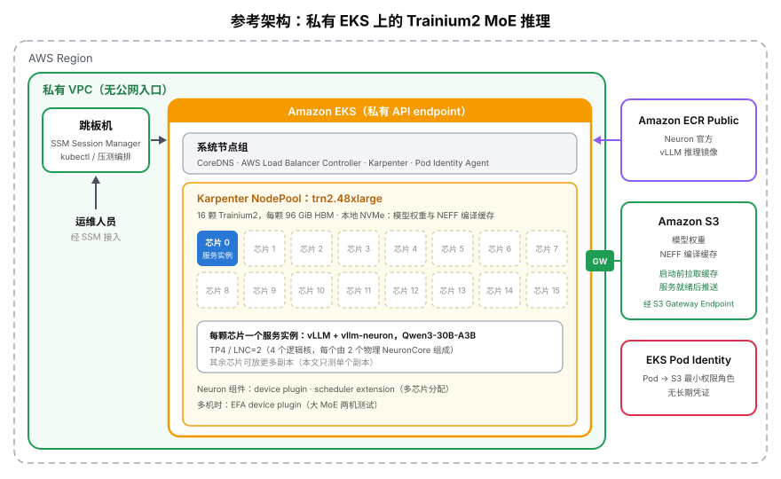
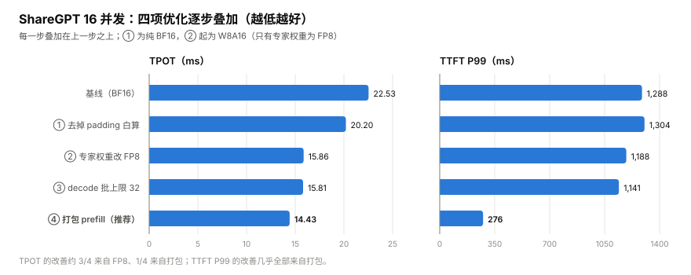
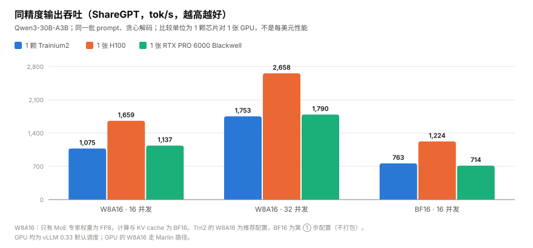
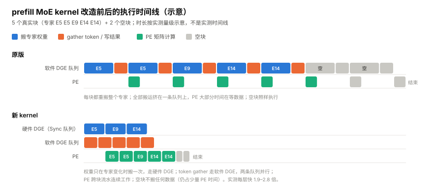
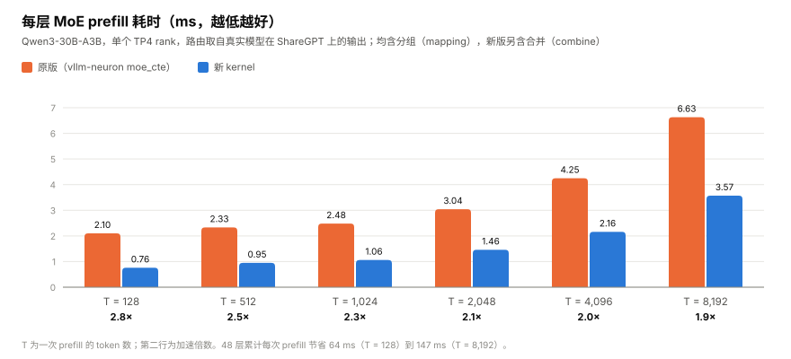
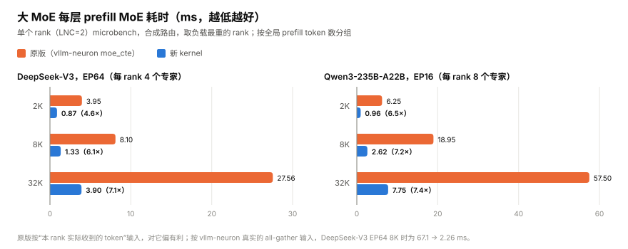

# 在 AWS Trainium2 上服务 MoE 模型：Qwen3-30B-A3B 单芯片优化实践与 kernel 原理

**摘要：** 本文以 Qwen3-30B-A3B 为例，在 Amazon EKS 上基于 Amazon EC2 Trn2 实例，实测单颗 Trainium2 芯片服务 MoE 模型的能力，并与单张 H100、单张 RTX PRO 6000 Blackwell 做同口径、同精度对比。在一套已做过 decode 优化的配置上叠加 FP8 专家权重、decode kernel 去掉 padding 白算、bs32 decode 和多请求打包 prefill 四项优化后，16 并发吞吐提升 56%，TTFT P99 降低 79%，精度不降、长时间 soak 无失败。文章重点解释 MoE 在 Trainium2 上快慢的原理：decode 受 HBM 带宽限制，prefill MoE 的瓶颈在数据搬运的编排，首 token 延迟的长尾来自调度；并展示同样的方法在 DeepSeek-V3、Qwen3-235B 等大 MoE 上的收益，最后给出负载选型、编译与冷启动、自定义 kernel 上线检查和 POC 压测的建议。

**目录**

- 一、背景：客户为什么关心 Trainium 上的 MoE 推理
- 二、参考架构
- 三、测试口径
- 四、结果：优化收益与 GPU 同精度对比
- 五、原理：为什么快、快在哪里
- 六、延伸：大 MoE（DeepSeek-V3、Qwen3-235B-A22B）
- 七、生产化建议
- 八、POC 压测注意事项
- 九、总结
- 十、附录

## 一、背景：客户为什么关心 Trainium 上的 MoE 推理

### 1.1 典型问题

开放权重模型里，MoE（Mixture of Experts）已经是主流：Qwen3、DeepSeek-V3、gpt-oss 都是“总参数大、每个 token 只激活一小部分”。客户在评估 Trainium 时，最常问三个问题：

- **能不能跑我的 MoE 模型？** 推理框架和 kernel 对新架构的支持程度如何；
- **同精度下和 GPU 比怎样？** 逐 token 延迟（TPOT）、吞吐和首 token 延迟（TTFT）分别差多少；
- **要投入多少工程量？** 哪些开箱即用，哪些需要自己写 kernel。

MoE 让第三个问题格外重要。以 Qwen3-30B-A3B 为例，每层 128 个专家选 8 个，单个专家每层的 BF16 权重只有约 9.4 MB；16 个请求一起 decode 一步，每层要读到的专家并集约 82 个，48 层合计约 37 GB，而矩阵计算量很小。也就是说，**MoE 推理的速度主要取决于权重从显存搬到计算单元的效率**。GPU 有缓存和大量线程替你掩盖访存延迟；Trainium 上搬运是显式编排的，kernel 写法的差距可以是数倍。

本文以 Qwen3-30B-A3B 在单颗 Trainium2 上的优化为例回答这三个问题，重点解释 kernel 层面的原理，再看同样的方法在大 MoE 上的效果，最后给出生产化建议。

### 1.2 本文要点

- 单颗 Trainium2 芯片可以服务 Qwen3-30B-A3B（8K 上下文）。在一套已做过 decode 优化的配置上叠加四项优化后，ShareGPT 16 并发的 TPOT 从 22.5 降到 14.4 ms（−36%），吞吐从 688 升到 1,075 tok/s（+56%），TTFT P99 从 1,288 降到 276 ms（−79%）；32 并发吞吐 1,753 tok/s。GSM8K 没有下降，51 分钟 soak 0 失败。
- **同精度**（只把专家权重存成 FP8、计算仍为 BF16，即 W8A16）下，单颗 Trainium2 与 1 张 RTX PRO 6000 Blackwell 的 decode 基本持平（16 并发 TPOT 1.04 倍），吞吐约为 1 张 H100 的 0.65 倍（TPOT 1.54 倍）。首 token 延迟和长 prompt 场景落后于两者。本文没有做成本对比。
- 原理上，MoE 在 Trainium2 上首先是数据搬运问题：decode 受 HBM 带宽限制，收益来自少搬字节、不白算 padding；官方 prefill MoE 路径慢在每个 token 块都重搬专家权重、搬运挤在一条软件生成描述符的队列上、按最坏情况执行空块，重写后每层快 1.9–2.8 倍；TTFT 长尾来自调度（每步只跑一条 prefill），靠打包解决。
- 同样的原则在大 MoE 上收益更大：DeepSeek-V3、Qwen3-235B 的单层 prefill MoE 在主要 EP 配置下快 4.6–7.9 倍；DeepSeek-V3 两机端到端的长 prompt TTFT 降低 53–59%，精度和 soak 通过。Qwen3-235B 端到端未通过精度验证，本文只总结其中的经验。

### 1.3 测试说明

测试时间为 2026 年 11 月，软件栈为 Neuron SDK 2.33 + vLLM 0.29 / vllm-neuron 0.29。文中的 MoE kernel、调度补丁和部分模型代码是为本次测试自研的，不在官方发布版本中。具体数字会随版本演进变化，本文结论尽量落在原理层面。完整版本信息与局限说明见第十章附录。

## 二、参考架构

### 2.1 架构总览



### 2.2 关键设计

- **全链路私有**：EKS 使用私有 API endpoint，运维通过 SSM 访问跳板机，推理服务没有公网入口；Pod 通过 EKS Pod Identity 访问 S3，没有长期凭证。生产环境建议为推理 Pod 和写缓存的任务分别绑定最小权限的角色。
- **一颗芯片一个服务实例**：Qwen3-30B 配置只用 1 颗 Trainium2（TP4，LNC=2，即 4 个逻辑核，每个由 2 个物理 NeuronCore 组成）。一台 trn2.48xlarge 有 16 颗芯片，理论上可以放 16 个这样的副本；本文只测了单个副本。
- **多芯片调度走 Neuron scheduler extension**：同一节点上的 Pod 申请部分芯片时，由 Neuron 的调度扩展分配设备；所有 Neuron Pod 都要走同一个调度器（见 7.3 节）。
- **NEFF 编译缓存放 S3**：Neuron 需要把计算图提前编译成 NEFF，这是冷启动最大的耗时项。编译产物推到 S3，新节点启动前拉取（见 7.2 节）。

基础设施（VPC endpoint、EKS、Karpenter NodePool、Neuron 组件）可以参考 [aws-samples/sample-eks-enterprise-quickstart](https://github.com/aws-samples/sample-eks-enterprise-quickstart)，其 main 分支已加入 Trainium 支持（Neuron 节点组、Karpenter NodePool、Neuron device plugin 与 scheduler）。推理层的 Kubernetes 清单不在该仓库中，关键参数见 10.2 节。

## 三、测试口径

### 3.1 被测对象与负载

| 项 | 内容 |
|---|---|
| 模型 | Qwen3-30B-A3B，BF16 checkpoint，48 层，128 专家选 8，max-model-len 8192 |
| Trainium2 | 1 颗 Trainium2（取自 trn2.48xlarge），TP4 / LNC=2；vLLM 0.29 + vllm-neuron 0.29 |
| GPU 对照 | p5.48xlarge 中 1 张 H100（TP1）；g7e.4xlarge（1 张 RTX PRO 6000 Blackwell Server Edition）。两者都是 vLLM 0.33，同一个镜像 |
| 服务参数 | 三方对齐：max-model-len 8192、max-num-batched-tokens 8192；16 并发及以下 max-num-seqs 16，32 并发另起 max-num-seqs 32 的服务 |
| 采样 | 三方都是贪心解码（GPU 在服务端强制 temperature 0） |
| 负载 | ShareGPT 输出 512，并发 1 / 4 / 16 / 32 分别 12 / 32 / 64 / 128 条，seed 42（4、16 并发另用 seed 123 复跑），三方每档输入 token 总数逐一相同；随机 1K / 4K → 512，16 并发。每次压测前清空 prefix cache |
| 精度与稳定性 | GSM8K 500 题（zero-shot chat，关闭 thinking，标准误约 1.1 个百分点）；50–70 分钟混合负载 soak |

截至测试时，vllm-neuron 0.29 的官方发布没有注册 Qwen3 MoE。我们的起点是 vllm-neuron 社区 PR 中的 Qwen3 MoE 模型实现（测试时尚未合入），在此基础上替换了 MoE kernel、修改了调度器。

### 3.2 精度口径

精度是对比里最容易混淆的地方，本文严格区分两种：

- **BF16**：权重、计算、KV cache 全为 BF16。
- **W8A16**：只有 MoE 专家权重是 FP8（e4m3，每个专家一个标量 scale），attention、lm_head 等其余权重以及计算、KV cache 仍为 BF16。三方的量化方案相同，实现不同：Trainium2 为自研 NKI kernel，GPU 为 vLLM 的 Marlin 路径（先反量化再做 BF16 矩阵乘）。

**同精度比**指 BF16 对 BF16、W8A16 对 W8A16。把 W8A16 的 Trainium2 和 BF16 的 GPU 放在一起比是**跨精度参考**，本文单独列出，不作为结论。

## 四、结果：优化收益与 GPU 同精度对比

### 4.1 从基线到推荐配置

基线是一套已经做过 decode 优化的 BF16 配置（含自写的融合 decode MoE kernel，以及 5.3 节的新 prefill MoE kernel）。下表每一步都叠加在上一步之上，ShareGPT 16 并发（seed 42）实测：

| 步骤 | 精度 | TPOT（ms） | 吞吐（tok/s） | TTFT P99（ms） |
|---|---|---|---|---|
| 基线 | BF16 | 22.53 | 688 | 1,288 |
| ① decode MoE kernel 去掉 padding 白算 | BF16 | 20.20（−10%） | 763（+11%） | 1,304 |
| ② 专家权重改 FP8 | W8A16 | 15.86（−21%） | 969（+27%） | 1,188 |
| ③ decode 批上限 16 → 32 | W8A16 | 15.81 | 974 | 1,141 |
| ④ 多请求打包 prefill（**推荐配置**） | W8A16 | **14.43**（−9%） | **1,075**（+10%） | **276**（−76%） |

括号里是相对上一行的变化。推荐配置的其余档位：1 并发 TPOT 5.85 ms、TTFT P99 96.5 ms；4 并发 TPOT 8.85 ms、432 tok/s；32 并发 TPOT 17.24 ms、**1,753 tok/s**、TTFT P99 581 ms。



读这张表时注意：

- **TPOT 的改善约 3/4 来自 FP8，约 1/4 来自打包；TTFT P99 的改善几乎全部来自打包。** 按叠加顺序拆（不是正交分解），16 并发 TPOT 共降 5.77 ms，其中 FP8 占 4.34 ms，打包占 1.38 ms。
- 第 ① 步是纯 BF16 的 kernel 改动，**不接受 FP8 的场景可以单独使用**，没有数值风险。
- 第 ③ 步的价值在 32 并发：decode 受带宽限制，批从 16 加到 32，每步只慢约 20%（纯 decode 14.0 → 16.8 ms）。但不打包时，32 条突发请求的 prefill 串行排队，TTFT P99 达 2.4 s，所以 ③ 要和 ④ 一起用。

### 4.2 精度与稳定性

- GSM8K 500 题：基线 0.934，FP8 各配置（含推荐配置）均为 0.946。差异在噪声范围内，结论是“FP8 专家权重没有让精度变差”，而不是“变好”。
- 三次 soak 共 20,052 个请求，0 失败。推荐配置的 soak 为 50.8 分钟、6,089 个请求（其中 32 并发 2,827 个，随机长 prompt 3,035 个，prefill 合计 1,362 万 token），NaN 检查和金丝雀请求全部通过。启发式规则报出的 2 条“重复字符”样本，重跑后确认是正常内容（markdown 表格的空格补齐、照抄 prompt 里的注释分隔线）。

### 4.3 与 GPU 的同精度对比

W8A16 对 W8A16（Trainium2 为推荐配置）：

| 场景与指标 | Trainium2 | H100 | RTX PRO 6000 | 相对 H100 | 相对 RTX PRO 6000 |
|---|---|---|---|---|---|
| 1 并发 TPOT（ms） | 5.85 | 4.92 | 5.66 | 1.19× | 1.03× |
| 4 并发 TPOT（ms） | 8.85 | 6.49 | 8.92 | 1.36× | 0.99× |
| 4 并发吞吐（tok/s） | 432 | 593 | 441 | 0.73× | 0.98× |
| 16 并发 TPOT（ms） | 14.43 | 9.38 | 13.81 | **1.54×** | **1.04×** |
| 16 并发吞吐（tok/s） | 1,075 | 1,659 | 1,137 | **0.65×** | **0.95×** |
| 16 并发 TTFT P99（ms） | 276 | 160 | 160 | 1.7× | 1.7× |
| 32 并发 TPOT（ms） | 17.24 | 11.40 | 17.16 | **1.51×** | **1.00×** |
| 32 并发吞吐（tok/s） | 1,753 | 2,658 | 1,790 | **0.66×** | **0.98×** |
| 32 并发 TTFT P99（ms） | 581 | 254 | 290 | 2.3× | 2.0× |
| GSM8K 500 题 | 0.946 | 0.932 | 0.932 | — | — |

BF16 对 BF16（Trainium2 为第 ① 步配置：不打包、max-num-seqs 16，所以没有 32 并发）：

| 场景与指标 | Trainium2 | H100 | RTX PRO 6000 | 相对 H100 | 相对 RTX PRO 6000 |
|---|---|---|---|---|---|
| 1 并发 TPOT（ms） | 6.44 | 4.75 | 6.72 | 1.36× | 0.96× |
| 4 并发 TPOT（ms） | 10.98 | 8.34 | 12.68 | 1.32× | 0.87× |
| 4 并发吞吐（tok/s） | 350 | 463 | 312 | 0.76× | 1.12× |
| 16 并发 TPOT（ms） | 20.20 | 12.82 | 22.15 | **1.58×** | **0.91×** |
| 16 并发吞吐（tok/s） | 763 | 1,224 | 714 | **0.62×** | **1.07×** |
| 16 并发 TTFT P99（ms） | 1,304 | 146 | 162 | 8.9× | 8.1× |
| GSM8K 500 题 | 0.934 | 0.930 | 0.930 | — | — |

“相对”一列为 Trainium2 ÷ GPU：TPOT、TTFT 大于 1 表示 Trainium2 更慢，吞吐小于 1 表示 Trainium2 更低。吞吐均为输出 tok/s。



长 prompt、prefill 比重大的负载（W8A16，16 并发）。推荐配置没有跑这两档，Trainium2 用不打包的第 ③ 步配置；其中 1K 输入在推荐配置下可以打包，实际结果可能好于表中数字，4K 输入超过打包预算，结果应与表中相同：

| 场景与指标 | Trainium2 | H100 | RTX PRO 6000 | 相对 H100 | 相对 RTX PRO 6000 |
|---|---|---|---|---|---|
| 1K → 512 TPOT（ms） | 16.08 | 9.25 | 12.89 | 1.74× | 1.25× |
| 1K → 512 吞吐（tok/s） | 943 | 1,628 | 1,182 | 0.58× | 0.80× |
| 1K → 512 TTFT P99（ms） | 1,439 | 412 | 482 | 3.5× | 3.0× |
| 4K → 512 TPOT（ms） | 22.33 | 11.19 | 16.92 | 2.00× | 1.32× |
| 4K → 512 吞吐（tok/s） | 647 | 1,240 | 844 | 0.52× | 0.77× |
| 4K → 512 TTFT P99（ms） | 3,332 | 1,590 | 2,123 | 2.1× | 1.6× |

### 4.4 怎么读这组对比

- **和 H100 的 decode 差距在两种精度下几乎一样**：16 并发 TPOT，BF16 是 1.58 倍，W8A16 是 1.54 倍。H100 用上 FP8 权重后自己也快了 27%（12.82 → 9.38 ms），所以 Trainium2 这边的 FP8 收益并没有缩小与 H100 的差距。
- **和 RTX PRO 6000 相比**：BF16 时 Trainium2 略快（16 并发 TPOT 0.91 倍），W8A16 时基本持平（16 并发 1.04 倍，32 并发 1.00 倍）。RTX PRO 6000 的显存带宽更低（规格约 1.8 TB/s），权重字节减半给它带来的收益更大（TPOT −38%，Trainium2 是 −21%）。
- **首 token 延迟和长 prompt 是 Trainium2 当前的短板**：单请求 TTFT 比两张 GPU 都高；prefill 比重大的负载上，吞吐只有 H100 的 0.52–0.58 倍、RTX PRO 6000 的 0.77–0.80 倍。原因见 5.4 节。
- **跨精度参考**（只作参考，不代表 decode 追近了 H100）：W8A16 的 Trainium2 对 BF16 的 H100，16 并发 TPOT 1.13 倍、吞吐 0.88 倍；基线时分别是 1.76 倍和 0.56 倍。这个比值的缩小，主要反映的是“Trainium2 上了 FP8、H100 没上”。
- GPU 上的 W8A16 不是理论最优：Marlin 路径先反量化再算，1 并发时甚至比 BF16 略慢（H100 4.92 vs 4.75 ms）。H100 使用官方 FP8 checkpoint（W8A8）时 16 并发 TPOT 为 8.98 ms，比 W8A16 再快约 4%；Trainium2 没有对应的 W8A8 实现，没有放进表里。
- 比较的单位是“1 颗芯片”对“1 张 GPU”，不是每美元性能。**本文没有做成本对比**，估算方法见 7.4 节。

## 五、原理：为什么快、快在哪里

### 5.1 Trainium2 的执行模型

每个 NeuronCore 里有几种各自执行指令流的引擎：PE（128×128 的矩阵乘阵列）、ACT（激活函数等逐元素运算）、DVE（向量运算和拷贝）、GpSimd（通用小核）。计算只能读片上内存 SBUF（每核约 24 MiB）；权重和 KV cache 放在 HBM（每芯片 96 GiB，约 2.9 TB/s）。

和 GPU 最关键的区别是：**没有自动缓存，也没有成千上万个线程来掩盖访存延迟**。HBM 到 SBUF 的每一次搬运，都由 kernel 显式发起一条 DMA；搬运和计算能否重叠，要写在程序里。另外，计算图的形状和循环次数在编译时就要确定。

MoE 的搬运地址取决于运行时的路由结果，DMA 描述符要在运行时生成，有两种方式：

| | 软件 DGE | 硬件 DGE |
|---|---|---|
| 谁生成描述符 | GpSimd 引擎逐条计算 | DMA 硬件按一条指令展开 |
| 适合 | 每一行地址都不同的逐行 gather | “一个动态基地址 + 固定形状”的整块搬运 |
| 注意 | 大块连续搬运时同样能跑到约 348 GB/s/物理核；描述符细碎时 GpSimd 会成为瓶颈 | 不占 GpSimd，与软件 DGE 是两条可以并行的通道 |

### 5.2 decode：带宽受限，收益来自少搬字节、不白算

**诊断**：基线下 16 并发 decode 一步约 21 ms，要读约 39.6 GB（专家并集 37.1 GB、attention 1.8 GB、lm_head 0.6 GB），折合 1.88 TB/s，约为 HBM 峰值的 65%；同条件下 H100 约为 92%。其中 MoE 约占一步的 85%。另外，16 并发 ShareGPT 的 ITL 中位数（21.0 ms）和纯 decode 几乎相同，说明 TPOT 的差距主要在 decode 单步本身，prefill 插入只占约 7%。

**第一个问题：padding 位置在白算。** 计算图形状是静态的，decode MoE kernel 按最坏情况展开 min(64, 4T) 个“token × 专家”位置（T 为批大小）。用不到的位置虽然跳过了 DMA，但矩阵乘、激活照算，而且全部排在最后，形成一条串行尾巴：T=16 时每层约 56 µs，48 层合计约 2.7 ms，约占 TPOT 的 12%。改法是让 padding 位置和真实位置交错，消掉串行尾巴，同时把 kernel 支持的批大小扩到 32。T=16 时每层 MoE 从 378 降到 338 µs，端到端 TPOT −10%（4.1 节第 ① 步）。

**第二个问题：字节数本身。** 真实位置上，每个物理核的搬运已经达到约 315 GB/s（约为峰值的 87%），每个分区都是 12 KiB 的连续块，“把搬运做得更大块”已经没有空间。设备 profile 显示，FP8 版 kernel 的字节数和执行时间都减半，HBM 读速率不变。**decode MoE 受 HBM 带宽限制，少搬字节就是直接收益**：专家权重改 FP8 后，T=16 时每层从 338 降到 202 µs，纯 decode 16 批一步从 18.3 降到 14.0 ms。FP8 的 scale 合并进激活和路由权重里，kernel 内没有额外开销。

为什么用“每个专家一个标量 scale”而不是 per-channel：用真实权重测，两者的量化误差几乎一样（2.65% vs 2.64%，e4m3 是浮点格式，误差对 scale 粒度不敏感），而 per-channel 每个专家要多一次零碎的 scale 搬运，每层多约 60 µs。

**剩下的差距在哪**：推荐配置下 16 批 decode 一步的设备 profile（每层中位数）：

| 部分 | µs / 层 | 占比 |
|---|---|---|
| MoE | 157.2 | 59.6% |
| attention（qkv / o_proj / KV 写回） | 74.3 | 28.3% |
| 两次 all-reduce | 19.6 | 7.5% |

- MoE 同时卡在两个上限上。FP8 权重作为 PE 的 moving 操作数时，单条矩阵乘耗时和 BF16 一样，也就是 **FP8 只省了 HBM 字节，没有换来 PE 加速**；而 HBM 侧离单 rank 能分到的带宽只剩约 15%。所以即使改成 W8A8 让 PE 跑 FP8 速率，收益上限也只有约 15%，还要重新做精度验证。
- attention 不受带宽限制（每层只读约 17.6 MB），开头 10–17 µs 只有 GpSimd 在按 block table 收集并转置 K。去掉这一段需要改 K cache 的存储布局，估计收益 5–7%，但要同时改 prefill 写 cache、attention 和 decode 多条路径。

这两项合计上限约 20%，都是多天的工作量，我们停在了推荐配置。

### 5.3 prefill：重写 MoE kernel，每层快 1.9–2.8 倍

vllm-neuron 中的 MoE 模型在 prefill 时都走同一条官方路径（`moe_cte` → nkilib 的 blockwise kernel）：把每个专家分到的 token 切成 128 token 一块，按最坏情况预留块数，逐块计算。在 T=2048（一次 prefill 2,048 个 token）下逐层 profile，问题有四个：

| 问题 | 实测（每个物理核） |
|---|---|
| ① 权重不复用 | 每块都重新搬一次该专家的权重（TP4 切分后约 2.25 MB），即使相邻两块是同一个专家；加上 token gather 和输出读改写，每块约 3.4 MB |
| ② 所有搬运挤在一条软件 DGE 队列 | 98% 的 DMA 字节走软件 DGE，实测只有约 135 GB/s；GpSimd 71% 的时间在生成描述符 |
| ③ 空块照样执行 | 按最坏情况预留 191 块，真实只有约 145 块 |
| ④ 分组本身很重 | 分组（mapping）里有 TP 集合通信，每层约 0.33 ms |
| 结果 | 每块约 28 µs，而理想的矩阵计算只要约 7 µs，PE 大部分时间在等数据 |

需要强调的是，软件 DGE 本身并不慢。原版慢在“每块都重搬整个专家”和“搬运被拆成大量细碎描述符、全靠 GpSimd 现算”。

新 kernel 做了五个改动：

1. **按专家顺序排队，权重只在专家变化时才重新搬**：所有真实块按专家编号排成一列，切成 8 段连续的 lane（2 个物理核 × 每核 4 条），每条 lane 在 SBUF 里有自己的权重缓冲。
2. **权重走硬件 DGE，token gather 走软件 DGE**：专家权重是“专家号一个动态偏移 + 固定形状”的整块拷贝，交给 Sync 引擎队列上的硬件 DGE；逐行 token gather 留在软件 DGE，两条队列并行。
3. **空块跳过所有搬运**：循环次数仍是编译期常量，但空块的 token 下标为 −1，所有 DMA 按越界跳过，一个字节都不搬。
4. **静态展开 + 跨块软件流水**：每块在 PE 上分 4 个阶段，每个阶段都要等前一步激活的结果。新 kernel 把指令排成 S3(k) S2(k+1) S1(k+2) S4(k)，PE 等待时去做其他块的活。
5. **分组和合并变轻**：每个 rank 自己扫描 128 个专家完成分组，不再需要集合通信；专家输出直接写到按 token 排列的位置，再用一个小 kernel 以 fp32 求和。相对 fp32 参考的误差从 4.36e-3 降到 2.87e-3。



**为什么不用动态循环（运行时只跑真实块数）？** 我们试过：动态循环每次迭代进出都会清空所有 DMA 队列、让所有引擎做一次屏障同步，两个物理核的迭代次数还必须相同。实测按专家动态循环 4.3 ms，比原版的 2.7 ms 还慢。原因是 Qwen3-30B 的专家很小，每块只算几微秒，每次迭代几十微秒的同步开销占比太大。对 DeepSeek-V3 这样的大专家，每组计算约 0.7 ms，动态循环的开销就可以忽略（见第六章）。**静态还是动态，取决于每次迭代的计算量。**

每层 MoE prefill 耗时（单个 TP4 rank，路由取自真实模型在 ShareGPT 文本上的输出）：

| prefill token 数 | 128 | 512 | 1024 | 2048 | 4096 | 8192 |
|---|---|---|---|---|---|---|
| 原版（kernel + 分组），ms | 2.10 | 2.33 | 2.48 | 3.04 | 4.25 | 6.63 |
| 新版（kernel + 分组 + 合并），ms | 0.76 | 0.95 | 1.06 | 1.46 | 2.16 | 3.57 |
| 加速 | 2.8× | 2.5× | 2.3× | 2.1× | 2.0× | 1.9× |



端到端同时段 A/B（改造前的配置已做过 decode 优化，只有 prefill MoE 仍用原版）：

| 指标 | 改造前 | 改造后 | 变化 |
|---|---|---|---|
| 单请求 TTFT，输入 256 / 1,024 token | 119.9 / 154.2 ms | 67.9 / 93.8 ms | −43% / −39% |
| 单请求 TTFT，输入 3,000 / 6,000 token | 308.3 / 543.8 ms | 219.1 / 420.2 ms | −29% / −23% |
| ShareGPT 16 并发 TTFT 均值（两组 seed） | 584.9 / 561.5 ms | 354.5 / 336.5 ms | −39% / −40% |
| ShareGPT 16 并发 TPOT | 23.83 / 24.16 ms | 22.54 / 22.71 ms | −5% / −6% |
| ShareGPT 16 并发吞吐 | 640 / 618 tok/s | 688 / 667 tok/s | +7.5% / +7.9% |
| 1 并发 TPOT | 6.44 ms | 6.44 ms | 不变 |

- 短 prompt 的 TTFT 降约 40%；长 prompt 降 23–29%，因为长 prompt 里 attention 等非 MoE 部分的占比更高。
- decode 的计算图逐字节没有变，所以 1 并发 TPOT 完全不变；并发时 TPOT 小幅下降，是因为 prefill 变短，decode 被阻塞的时间少了。
- 另写客户端独立复现，结论一致；71 分钟 soak 0 失败。

还没做完的部分：T=2048 时 kernel 为 1.06 ms，而把所有 DMA 都跳过后的下限是 0.79 ms；空块虽然不搬数据，仍占 PE 时间（静态项里 20–28% 是空块）；PE 有功耗节流，平均只有满速的 75–80%。

### 5.4 调度：TTFT 长尾来自“每步只跑一条 prefill”

基线 16 并发时，开头 16 个同时到达的请求，TTFT 呈阶梯状：65 → 128 → 199 → … → 1,311 ms，每级 75–90 ms。原因是 vllm-neuron 的调度器每个 step 只允许一条 prefill，而短 prompt 的 prefill 同样受权重带宽限制（每次都要读全部 128 个专家，约 58 GB），16 条就要读 16 遍。GPU 上的 vLLM 则会把这 16 条打包进同一个 step。调“两次 prefill 之间插几个 decode step”的参数，只能在 TTFT P99 和 TTFT 均值、decode 抖动之间挪，治本的办法是打包。

多请求打包 prefill 的做法：

- 模型运行时的输入构建本来就是多请求的写法（继承自 GPU 版 vLLM），attention 用 nkilib 自带的序列打包（块对角 causal mask），不用新写 kernel。真正写死“只有一条”的地方只有 4 处：调度器准入、调度器补齐、prefill 图里请求数那一维、attention 调用。
- 调度器只打包满足条件的请求：新请求、整条 prompt 能放进预算、前缀缓存未命中、没有结构化输出或多模态。按先到先服务累计到最多 16 条或 4,096 token。
- 请求数那一维固定为 16，每个打包长度档位只多编译 1 个图。

效果：32 并发配置下，16 条 prompt 同时到达时，逐条处理要 6.90 s，打包后约 1.2 s（一个 step 最多装 14 条）；16 并发 TTFT P99 从 1,141 降到 276 ms（另一组 seed 从 1,213 降到 381 ms）。代价是 TTFT 中位数略升（213 → 255 ms），因为同一个打包 step 里最短的请求要等最长的请求一起算完。超过 4,096 token 的长 prompt 不打包，结果与不打包相同。

与 GPU 剩下的 TTFT 差距有三个来源：打包预算限制了长 prompt；打包 step 里短请求等长请求；单条 prefill 本身就比 GPU 慢（单请求 TTFT：128 token 54 ms，2,048 token 119 ms，4,096 token 197 ms，8,000 token 390 ms）。

### 5.5 哪些结论可以推广

- **可以推广的**：上面 prefill 的四个问题都来自官方 kernel 的结构，不在 Qwen3 里，vllm-neuron 中的 MoE 模型 prefill 都走同一条路径。“专家多、每个专家小”的模型吃亏最多，收益也最大；prefill 占比越高（长输入、RAG、Agent 多轮），收益越大。decode“带宽受限、FP8 只省字节”的判断对小批 decode 普遍成立。
- **大专家要改写法**：每块的计算 / 搬运比只取决于一次搬进来的权重被多少个 token 用，和专家大小无关，所以大专家同样受益；但大专家的权重放不进 SBUF（DeepSeek-V3 单个专家约 88 MB），需要改成“按权重分片流式搬运、每片在该专家的所有 token 之间复用”（见第六章）。
- **不能直接推广的**：本文的实现是 Qwen3-30B 专用版，写死了专家数、隐藏维、TP4 切分和 BF16 激活；推广需要参数化形状、支持专家并行。

## 六、延伸：大 MoE（DeepSeek-V3、Qwen3-235B-A22B）

### 6.1 单层 microbench：同样的瓶颈，更严重

我们在单个 rank（LNC=2，2 个物理核）上，用两个大 MoE 的每 rank 形状测 prefill MoE 层：

| 模型 | 隐藏维 H | 专家中间维 I | 路由专家 | top-k | MoE 层数 | 单专家 BF16 权重 |
|---|---|---|---|---|---|---|
| DeepSeek-V3 | 7,168 | 2,048 | 256（+1 共享） | 8 | 58 | 约 88 MB |
| Qwen3-235B-A22B | 4,096 | 1,536 | 128 | 8 | 94 | 约 37.7 MB |

路由为合成（均匀、偏斜、分组），取负载最重的 rank（层耗时由最慢的 rank 决定）。结论是瓶颈与 Qwen3-30B 相同，而且更严重：DeepSeek-V3 EP64（每 rank 4 个专家）、全局 8,192 token 时，官方 kernel 每层 8.10 ms，而 PE 计算下限约 0.60 ms、每个专家权重只搬一次的下限约 0.49 ms；profile 显示 DMA 平均只有 131 GB/s，PE 的空洞都在等权重。另外，vllm-neuron 0.29 的专家并行 prefill 是先把所有 rank 的 token all-gather 到每个 rank，再按最坏情况预留块数，这种真实输入下同一个点要 67 ms/层。

新 kernel 改为**权重分片流式**：每个专家的 token 切成不超过 512 token 的段，每段让该专家的权重完整流过一次、段内所有 token 复用；段按长度配对分给两个物理核，让两核的循环次数严格相同；因为每组计算约 0.7 ms，这里改用只执行真实组的动态循环；权重全部走 Sync 队列的硬件 DGE，token gather 走软件 DGE。

| 配置（全局 token 数） | 原版（ms/层） | 新 kernel（ms/层） | 加速 |
|---|---|---|---|
| DeepSeek-V3 EP64，2K / 8K / 32K | 3.95 / 8.10 / 27.56 | 0.87 / 1.33 / 3.90 | 4.6× / 6.1× / 7.1× |
| Qwen3-235B EP16，2K / 8K / 32K | 6.25 / 18.95 / 57.50 | 0.96 / 2.62 / 7.75 | 6.5× / 7.2× / 7.4× |



- 表中原版的输入按“本 rank 实际收到的 token”计，这对原版是偏有利的口径；按 vllm-neuron 真实的 all-gather 输入，DeepSeek-V3 EP64 8K token 时是 67.1 → 2.26 ms。
- 数值：所有校验点相对 fp32 参考的误差为 2.4–2.9e-3（阈值 5e-3），覆盖均匀、偏斜、分组路由，全部 token 路由到同一组专家，以及 padding 等情况。
- **收益从哪来**（8K 点，按计时拆分）：只执行真实的组、不按最坏情况展开，贡献最大（DeepSeek-V3 约 2.4 倍、Qwen3-235B 约 4.6 倍）；其次是流水与布局（约 1.6 / 1.4 倍）；再次是段内权重复用（约 1.7 / 1.25 倍）。**把权重从软件 DGE 换到硬件 DGE 本身几乎没有差别**（1.25 vs 1.24 ms），关键是大块连续的权重单元，而不是 DGE 的类型。
- 每 rank 专家切得很细的并行方式（如 DeepSeek-V3 EP8 × TP8，I=256）只有约 2 倍，不推荐。

### 6.2 MoE 变快之后，瓶颈转向通信

我们实测了 trn2.48xlarge 单机 64 rank 的集合通信（bf16）：256 MB 消息时 all-gather 约 328 GB/s、reduce-scatter 约 260 GB/s（busbw），但 MoE 实际用到的中等大小消息（如 64 MB）只有峰值的 55–70%；all-to-all 在任何大小下都只有约 21 GB/s，不适合做专家并行的 dispatch / combine，all-gather + reduce-scatter 是更好的选择。两机（128 rank，经 EFA）时，大消息 busbw 约为单机的 60–65%，1 MB 消息的固定延迟多约 40 µs。

按实测带宽粗估（非 MoE 部分按 FLOPs 估），MoE 加速后，DeepSeek-V3 EP64 每层整体快约 2.7–3.2 倍，MoE 在层内的占比从 74–88% 降到 31–62%；Qwen3-235B EP16 每层快约 4.3–4.8 倍，占比从 87–94% 降到 46–70%。到 DeepSeek-V3 全局 32K token 时，all-gather + reduce-scatter（约 5.7 ms）已经超过 MoE 本身（约 3.9 ms）。**下一步的收益主要在通信与计算的重叠**；需要注意 Trainium2 的集合通信同样使用 DMA 引擎，会和 kernel 的权重流争用 HBM，重叠后两边都会变慢，需要实测。

### 6.3 端到端：DeepSeek-V3 通过，Qwen3-235B 未通过

**DeepSeek-V3**（BF16，两台 trn2.48xlarge，TP128 / EP128，max-model-len 4,096）。vllm-neuron 0.29 没有 DeepSeek-V3 的原生实现，这是我们为测试写的移植（MLA、分组路由、共享专家），5 层截断版与 HF transformers 的 CPU 参考逐字一致。新旧 kernel 在完全相同的配置下对比：

| 负载 | 原版 | 新 kernel | 变化 |
|---|---|---|---|
| 单请求 TTFT，输入 2,048 / 3,500 token | 1,115 / 1,118 ms | 454 / 528 ms | −59% / −53% |
| 随机 3,000 → 128，16 并发：TTFT 中位 / 总吞吐 | 9,468 ms / 1,296 tok/s | 3,889 ms / 1,777 tok/s | −59% / +37% |
| 随机 1,024 → 128，16 并发：TTFT 中位 / 总吞吐 | 2,893 ms / 927 tok/s | 1,456 ms / 1,072 tok/s | −50% / +16% |
| ShareGPT 16 并发：TTFT P99 / TPOT | 3,309–3,667 / 122.9 ms | 1,710–1,899 / 119.4 ms | 约 −48% / −3% |
| ShareGPT 1 并发 TPOT | 39.8 ms | 63.1 ms | 回退（见下） |
| GSM8K 500 | 82.0% | 81.2%（复测 82.6%） | 噪声范围内 |
| soak | — | 52.8 分钟，1,105 个请求，0 失败 | — |

- 端到端的 prefill 收益（TTFT −50–59%）小于单层 MoE 的收益（3–6 倍），因为 attention 和通信没有变。
- **1 并发 TPOT 有回退**：问题出在新 kernel 模式下 decode 图的构建（decode 不经过新 kernel），只影响批大小 1 的 decode 图，批大小 4 及以上时与原版持平。根因还没有定位。
- 这套移植的 decode 没有优化（decode 的 MoE 用 torch 实现），GSM8K 的绝对值也受我们的 prompt 模板影响。**表中数字只用于比较两种 prefill kernel，不代表 DeepSeek-V3 在 Trainium2 上可达到的绝对水平。**

**Qwen3-235B-A22B**（BF16，单台 trn2.48xlarge，TP64 / EP64）：新 kernel 的 prefill 收益同样明显（4,096 token 单请求 TTFT −44%，4K 输入 16 并发总吞吐 +58%），但 **GSM8K 只有 86.0%（原版 96.4%），约 10% 的请求输出乱码，soak 中出现设备显存分配失败，所以不能作为结论**。这个过程中的两条经验对写自定义 kernel 的团队有参考价值：

1. **动态循环里有软件 DGE 的 gather / scatter 时，紧接着的集合通信可能挂死。** 这个现象只在多 rank 的大图里出现，单 rank microbench 测不出来；需要把软件 DGE 的工作挪到静态循环里才能绕开。
2. **kernel 内部在 HBM 上申请的暂存区，不在 vLLM 启动时的显存估算里。** KV cache 按比例分满后，高并发和长 prompt 下就会显存不足。自定义 kernel 的临时缓冲应该作为计算图里的张量传入，让推理框架能看到。

## 七、生产化建议

### 7.1 什么负载适合

| 负载特征 | 建议 | 理由 |
|---|---|---|
| 中等规模 MoE（单芯片放得下）、对话类负载、16–32 并发 | **单芯片 + 推荐配置（W8A16 + 打包）** | 同精度下 decode 与 RTX PRO 6000 持平；32 并发 1,753 tok/s |
| 不接受 FP8 权重 | **单芯片 + 第 ① 步的 BF16 改动** | 零数值风险，16 并发 TPOT −10%、吞吐 +11% |
| prompt 以 4K token 以上为主（RAG、长文档） | 先用自己的数据实测 | 长 prompt 不打包；4K → 512 时吞吐只有 H100 的 0.52 倍、RTX PRO 6000 的 0.77 倍 |
| 对首 token 延迟有严格 SLO（如 P99 < 200 ms） | 先用自己的数据实测 | 16 并发 TTFT P99 为 276 ms，两张 GPU 均约 160 ms |
| 需要随机采样（temperature > 0） | 暂不能用打包 | 当前打包实现要求贪心解码 |
| DeepSeek-V3 级别的大 MoE | 先做 prefill kernel 验证 | prefill 收益明确，但端到端还有 decode 优化和稳定性工作要做 |

### 7.2 编译与冷启动

- **编译是冷启动最大的成本**：Qwen3-30B 单芯片配置换上新 prefill kernel 后，空缓存完整编译约 43 分钟（其中 8,192 token 的 prefill 图约 25 分钟，因为静态展开后图很大）；推荐配置在已有缓存基础上增量编译 31 个图，从启动到可服务约 1 小时。大模型更久：Qwen3-235B 单机编译加载约 2.3–2.5 小时，DeepSeek-V3 两机编译加预热约 7 小时。
- **把 NEFF 编译产物放到 S3 共享**：节点启动前拉取，服务就绪后推送。只缓存编译产物本身，不要带上节点本地的中间目录（会引用新节点上不存在的临时路径而报编译错误）。缓存命中要求镜像、模型代码、bucket 配置、LNC 和编译器版本都相同。实测一个 Qwen3-30B 配置从 S3 拉取 306 MB 只要 2 秒，全部命中，冷启动从 38.9 分钟降到 27.8 分钟；剩下的时间是图追踪、kernel 重编和逐 bucket 预热，S3 缓存消除不了。
- **bucket 的选择会直接改变延迟**：Neuron 按预编译的长度档位执行，请求长度向上取整到档位。单请求 TTFT 在 2,048 和 2,049 token 之间从 119 ms 跳到 197 ms，就是跨了档位。按业务的长度分布选档位，档位越多编译时间越长。
- **规划编译期的主机内存**：单芯片配置的编译峰值约 76 GiB；Qwen3-235B 单机编译约 1.3–1.5 TiB。
- **多机时调大 barrier 超时**：两台机器编译进度不同时，先完成的一方会在 barrier 处等待，vllm-neuron 默认 3,600 s 超时后初始化失败。我们设为 `VLLM_NEURON_BARRIER_TIMEOUT=14400`。

### 7.3 Kubernetes、容量与自定义 kernel 上线检查

- **所有 Neuron Pod 走同一个调度器**：申请部分芯片时要用 Neuron scheduler extension；如果有的 Pod 走默认调度器，extension 的占用表里没有它，会把已在用的芯片再分配出去。核对方法是比较各 Pod 里 `neuron-ls` 显示的 PCI 地址（容器内的设备名都会被重编号成 neuron0，看名字没用）。
- 只用 1 颗芯片、节点没有挂 EFA 时，Neuron SDK 2.33 的镜像需要设 `NEURON_SKIP_EFA_AFFINITY=1`，否则启动报错。
- **采购方式**：评测和 PoC 可以用 Spot，但要接受回收（本次测试中途就有节点被回收）；生产环境建议使用按需容量预留或 Capacity Blocks，长期负载结合 Savings Plans。

如果要在 Trainium2 上做类似的 kernel 优化，下面几条是我们踩过的坑：

| 检查项 | 我们遇到的问题 | 建议 |
|---|---|---|
| 新功能是否真的生效 | 打包补丁第一次上机时，编译、NaN 检查都通过，但实际每个 step 仍只有 1 条请求（异常被保守地吞掉了） | 给每个新功能定一个“确实生效”的正向指标（这里是多请求 prefill step 的计数），不能只看没报错 |
| padding / mask 的边界 | 打包后原来推断“最后一个真实 token”的方式会把其他序列判成 padding，MoE 输出被置零，不报错，只给出错误答案 | 边界用例里一定要有“多条序列等长”“全部 token 到同一组专家”等情况 |
| 贪心解码的一致性 | 同一组 prompt 逐条发和同时发，完全一致的只有 12/16；Neuron 上贪心解码本来就不是逐位可复现的 | 和“同一路径的 batch 噪声”这条基线比，不要求 100% 一致；用首 token 一致率加 GSM8K 500 题判断 |
| DMA 引擎的放置 | 不指定引擎的普通 DMA 可能被编译器放到与硬件 DGE 冲突的队列上，在特定执行历史下触发运行时错误 | kernel 里每条 DMA 都显式指定引擎；权重类 DMA 只从一条队列发出 |
| 显存 | kernel 内部的 HBM 暂存区不在推理框架的显存估算里（见 6.3 节） | kernel 的临时缓冲作为计算图里的张量传入 |
| 单测与端到端 | 单 rank microbench 测不出与集合通信有关的挂死；单核 microbench 也比端到端乐观（端到端里多个 rank 争 HBM） | 关键结论都要在服务里端到端复测，并跑 45 分钟以上、保存完整输出的 soak |

### 7.4 估算成本

本文没有做成本对比。估算自己场景下的单 token 成本可以用：

```
$/百万输出 token = 实例小时价 × 占用比例 ÷ (输出 tok/s × 3600 × 平均利用率) × 10^6
占用比例 = 服务占用的芯片或 GPU 数 ÷ 实例的芯片或 GPU 总数
```

代入时要用**自己业务数据**下测得的吞吐、实际采购价格（On-Demand / Savings Plans / Capacity Blocks）和真实利用率。按整机价格均摊到单芯片，前提是整机的副本都能被负载填满；用不满时，应按实际占用的实例计算。

## 八、POC 压测注意事项

下面几类问题在本次测试中都曾让数据出现偏差，为客户做 POC 时同样需要注意：

1. **采样方式要对齐**：vLLM 0.33 默认读取模型的 generation_config（Qwen3 为 temperature 0.6），客户端不传温度时 GPU 做的是随机采样。要在服务端强制 temperature 0，才和 Trainium2 的贪心解码可比。
2. **预热要覆盖 JIT 形状**：GPU 上的 Triton MoE kernel 会按形状即时编译，预热不够时 1 并发出现 600–760 ms 的 TTFT 尖峰。Trainium2 上则要确认所有 bucket 都在预热时编好，运行中没有意外重编译。
3. **每轮清空 prefix cache，并换 seed 复跑**：4 并发时出现过客户端相位造成的双峰分布，单次结果不可信。
4. **共享机器上的压测要串行**：同一台 trn2.48xlarge 上多个 Pod 同时压测会互相干扰，本次用文件锁串行化。
5. **GSM8K 至少 500 题**：200 题的标准误约 1.3 个点，不足以区分常见的优化前后差异。

另外，合成数据集和 ShareGPT 的长度分布未必代表客户的真实流量，最终结论应该用客户的真实请求回放复测。

## 九、总结

- **能不能在 Trainium2 上跑 MoE**：可以。但截至 Neuron SDK 2.33，Qwen3 MoE、DeepSeek-V3 还不在 vllm-neuron 官方发布的模型列表里，本文用的是社区实现和自研移植。
- **和 GPU 比怎样**：单颗 Trainium2 跑 Qwen3-30B-A3B，同精度下 decode 与 1 张 RTX PRO 6000 Blackwell 基本持平，吞吐约为 1 张 H100 的 0.65 倍；首 token 延迟和长 prompt 场景落后于两者。是否划算，取决于实际价格和利用率，需要按自己的负载估算。
- **要投入多少工程量**：官方 MoE 路径在 Trainium2 上留有数倍的优化空间。关键是按 Trainium2 的执行模型重新安排数据搬运：专家权重只搬一次、搬运与计算重叠、空块不搬、少搬字节（FP8），再加上调度层面的 prefill 打包。这些原则在 Qwen3-30B 上带来 prefill MoE 每层 1.9–2.8 倍、端到端 16 并发吞吐 +56%，在大 MoE 上的单层收益更大（4.6–7.9 倍）。自定义 kernel 必须经过端到端的精度、显存和长时间 soak 验证，microbench 通过不等于可以上线。

## 十、附录

### 10.1 测试环境与版本

| 项目 | 版本 / 配置 |
|---|---|
| Trainium2 实例 | trn2.48xlarge（16 × Trainium2，每颗 96 GiB HBM），Spot；Qwen3-30B 只用其中 1 颗 |
| Neuron 推理镜像 | `public.ecr.aws/neuron/pytorch-inference-vllm-neuronx:0.29.0.1.2.0-neuronx-py314-sdk2.33.0-ubuntu26.04` |
| 推理框架 | vLLM 0.29.0 + vllm-neuron 0.29（native torch.compile 路径）；Qwen3 MoE 模型代码来自 vllm-neuron 社区 PR，MoE kernel 与调度补丁为自研 |
| 模型 | `Qwen/Qwen3-30B-A3B`（BF16）；大 MoE 端到端为 `deepseek-ai/DeepSeek-V3`（官方 FP8 权重离线转换为 BF16）、`Qwen/Qwen3-235B-A22B`（BF16） |
| H100 对照 | p5.48xlarge 中 1 张 H100 80GB（TP1），Spot；驱动 580.178.04（CUDA 13.0）；vLLM 0.33.0 |
| RTX PRO 6000 对照 | g7e.4xlarge（1 张 RTX PRO 6000 Blackwell Server Edition 96 GB），Spot；vLLM 0.33.0（与 H100 同一镜像 digest） |
| 压测工具 | `vllm bench serve`，负载见第三章；GSM8K 500 题，zero-shot chat，关闭 thinking，温度 0 |
| 测试时间 | Qwen3-30B：2026-11-06 ～ 11-09；大 MoE microbench：11-07 ～ 11-08；大 MoE 端到端：11-08 ～ 11-10 |

三个平台在不同 Region 测试，单芯片 / 单卡的性能与 Region 无关。

### 10.2 推荐配置的关键参数

```bash
vllm serve Qwen/Qwen3-30B-A3B \
  --tensor-parallel-size 4 --max-num-seqs 32 --max-model-len 8192 \
  --max-num-batched-tokens 8192 --num-gpu-blocks-override 8704 \
  --additional-config '{"neuron_config":{
      "quantization":"bf16",
      "on_device_sampling_config":{"all_greedy":true},
      "num_batched_tokens_buckets":[128,256,512,1024,2048,4096,8192],
      "num_seqs_buckets":[1,4,8,16,32],
      "decode_context_length_buckets":[1024,2048,4096],
      "kv_segment_size_buckets":[8192]}}'
# 环境变量：NEURON_LOGICAL_NC_CONFIG=2（LNC=2）；单芯片且无 EFA 时 NEURON_SKIP_EFA_AFFINITY=1
# FP8 专家权重在加载时在线量化（由自研模型代码完成，所以 vLLM 这一层的 quantization 仍写 bf16）
# 打包参数：每个 step 最多 16 条请求、合计不超过 4,096 token；要求 all_greedy
```

- `--num-gpu-blocks-override 8704`：FP8 权重省出的显存用来把 KV block 从 4,352 加到 8,704，在 max-model-len 8192 下 KV 约可容纳 34 个满长请求。
- max-model-len 不要用 9216 这类数：块大小取最大公约数后会从 32 缩到 4，性能明显下降，应使用 8192 或 16384。
- 备选：只跑 16 并发以内时，可以去掉 32 的 decode 档位（16 并发 TPOT 14.70 ms、1,047 tok/s、TTFT P99 308 ms）；不需要打包时，TTFT P99 会回到 1.1 s（16 并发）和 2.4 s（32 并发）。

### 10.3 局限与声明

- 只测了单芯片上的单个服务副本。整机 16 个副本同时满载时，功耗节流和主机侧开销可能更重，没有测。
- 推荐配置的打包 prefill 要求贪心解码；所有平台的性能数据都是贪心解码下测得的。推荐配置没有跑 1K / 4K → 512 两档。
- GPU 对照使用 vLLM 默认调度（chunked prefill），Trainium2 使用自研打包调度，TTFT 的差异有一部分来自调度实现；GPU 的 W8A16 走 Marlin 路径，不是 GPU 上的最优 FP8 实现。
- 自研 kernel、调度补丁、DeepSeek-V3 移植均未合入官方发布，生产使用前请以正式发布的版本复测。
- 大 MoE 的 microbench 使用合成路由，真实模型的热点分布可能更偏斜；通信开销为基于实测带宽的估算。DeepSeek-V3 端到端的 decode 未优化，有一处 1 并发 TPOT 回退未定位根因；Qwen3-235B 端到端未通过精度与稳定性验证。
- 测试基于少量节点和短时间窗口，Spot 容量和价格情况不代表其他 Region 或时段。
- 第三方开放权重模型的许可条款与合规要求需由使用方自行评估。
